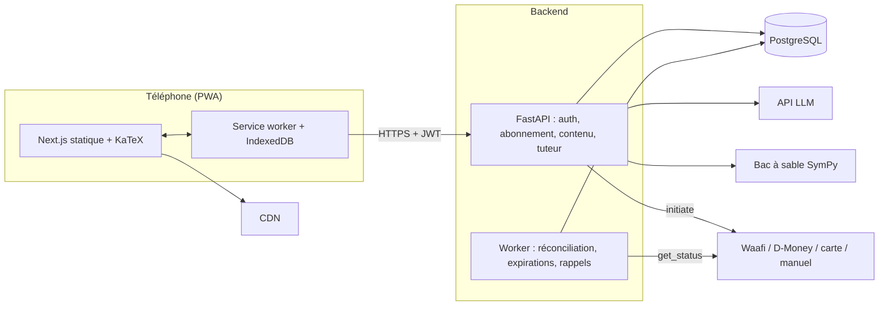

# Architecture

## Vue d'ensemble

PWA Next.js statique (CDN) → API FastAPI (monolithe modulaire) → PostgreSQL managé.
Un second processus du même code exécute les tâches de fond (réconciliation des paiements, expirations,
rappels). Le tuteur appelle un modèle de langage et un bac à sable SymPy.

## Décisions

| # | Décision | Raison |
| --- | --- | --- |
| 1 | Monolithe modulaire FastAPI | Un seul déploiement pour une équipe d'une à deux personnes |
| 2 | PostgreSQL managé, utilisé comme base seulement ; RLS refusée par défaut | Sauvegardes incluses, aucun accès direct du client |
| 3 | Pas de base vectorielle en V1 (recherche plein texte française sans accents) | Corpus de 9 chapitres ; un service de moins |
| 4 | Connexion téléphone + mot de passe, pas de SMS OTP | Coût et fiabilité sur réseau instable |
| 5 | Paiement derrière une interface `PaymentProvider`, repli manuel dès le jour 1 | Les API des opérateurs ne sont pas publiquement documentées |
| 6 | Modèle de langage derrière une interface `LLMClient`, choix confirmé par test sur un jeu de référence | La qualité en maths françaises doit être mesurée, pas supposée |

## Règles de code

- Dépendances autorisées entre modules : `auth` → `core` ; `billing` → `auth` ; `content` → `core` ;
  `progress` → `auth`, `content` ; `tutor` → `content`, `progress` ; `admin` → tous, par leurs services.
- L'accès payant se contrôle par une dépendance de route, jamais dans `content` ou `tutor`.
- Les règles d'abonnement vivent dans la base (`activate_payment`, `has_access`, contraintes) : un bug
  Python ne doit pas pouvoir créer deux périodes qui se chevauchent ni activer deux fois un paiement.
- Les montants sont des entiers de francs Djibouti.

## Écarts découverts à l'implémentation

- **Appareils.** Sans identifiant stable côté client, une reconnexion depuis le même téléphone comptait pour
  un 3e appareil. La migration `0002` ajoute `devices.client_device_id` et fait contrôler la limite aussi
  à la réactivation d'un appareil révoqué.
- **Limitation du débit de connexion.** Elle est en mémoire, donc propre à chaque instance. À déplacer en
  base avant de passer à 2 instances.
